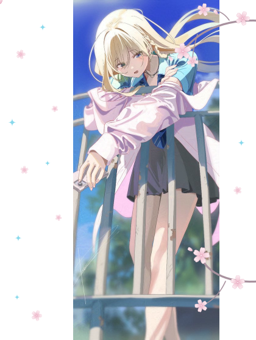

  <picture>
    <source media="(prefers-color-scheme: dark)" srcset="./assets/title-dark.svg">
    
  </picture>

  <code>CatnapzZ1</code>

  <picture>
    <source media="(prefers-color-scheme: dark)" srcset="https://readme-typing-svg.demolab.com/?font=Noto+Sans+SC&size=16&duration=3000&pause=1500&color=88D9EC&center=true&vCenter=true&width=420&height=30&lines=%E8%BF%99%E4%B8%8D%E6%98%AF%E6%8A%8A%E4%B8%80%E7%94%9F%E7%8C%AE%E7%BB%99%E8%B0%81%E7%9A%84%E6%95%85%E4%BA%8B">
    
  </picture>

 

  

 

  

  <em>也许我们永远都在寻找着“不明白的东西”的答案.</em>

  <picture>
    <source media="(prefers-color-scheme: dark)" srcset="https://github-stats-extended.vercel.app/api?username=CatnapzZ1&show_icons=true&hide_border=true&hide_rank=true&bg_color=00000000&title_color=88d9ec&icon_color=c7acbb&text_color=c9d1d9">
    
  </picture>
  <picture>
    <source media="(prefers-color-scheme: dark)" srcset="https://github-stats-extended.vercel.app/api/top-langs/?username=CatnapzZ1&layout=compact&langs_count=6&hide_border=true&bg_color=00000000&title_color=88d9ec&text_color=c9d1d9">
    
  </picture>

  <picture>
    <source media="(prefers-color-scheme: dark)" srcset="https://raw.githubusercontent.com/CatnapzZ1/CatnapzZ1/output/snake-dark.svg">
    
  </picture>

  <picture>
    <source media="(prefers-color-scheme: dark)" srcset="./assets/catnap-dark.svg">
    
  </picture>

