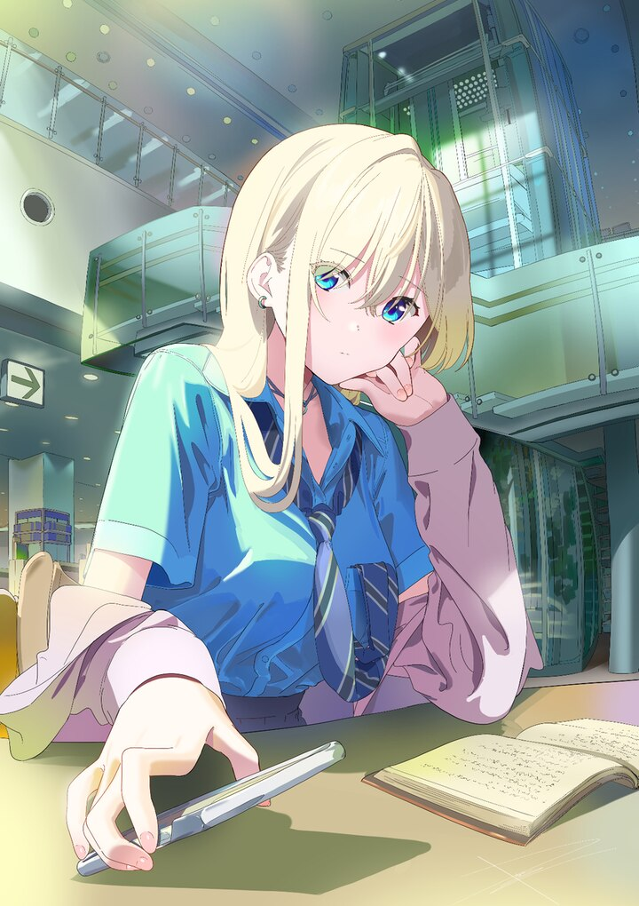

<!--
  Intentionally simple: one local image, one identity, one thought.
  To refresh the cover, replace assets/eraser.jpg and keep the same filename.
-->

  

 

<h1 align="center">Catnap_zZ</h1>

  <code>CatnapZZ1</code>

  <em>All roads lead to there.</em>

